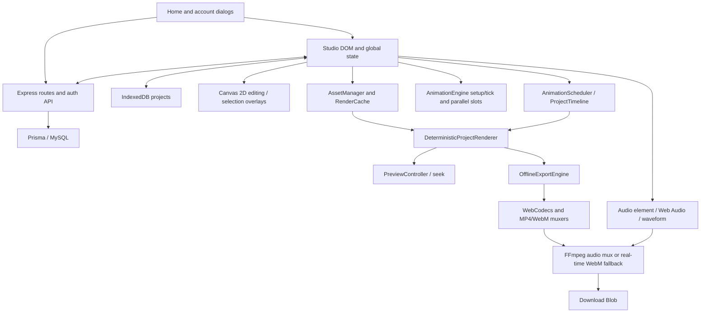

# Inkplainer architecture audit

Audit date: 2026-10-16. Scope: the working tree, including the recently rebuilt sidebar, not just HEAD. The baseline findings below preceded the subsequently requested implementation. The following section describes that implementation; baseline risks remain historical evidence unless explicitly resolved here.

## Implemented animation extension

- `animation-model.js` owns pure keyframe interpolation, presets, camera evaluation/inverse coordinates, framing and a version-2 legacy document adapter. It has no DOM dependency and is imported directly by unit tests.
- `animation-editor.js` owns transient timeline selection, drag, zoom and playhead UI state. Persistent animation fields remain on existing scene/layer records. It uses the existing renderer, project storage and undo stack rather than a second state store or canvas engine.
- `svg-drawing.js` compiles a conservative subset of SVG into native `Path2D` geometry with native path-length evaluation. Cached compilation is bounded to 32 sources/options. Absolute disconnected subpaths receive pen-up pauses. Strokes retain transforms, color, opacity, caps and joins. Filled shapes, filters, referenced content, dashed strokes and other unsupported geometry use the original image with explicit wipe/fade fallback. No invented stroke geometry is generated.
- `studio.html` integrates explicit millisecond clips, independent position/scale/rotation/opacity keys and a virtual camera into `DeterministicProjectRenderer`, shared by preview and offline export. Legacy projects without animation extensions continue using legacy preview selection. Scene and layer serialization, restoration and undo retain the added fields. SVG data URLs retain their geometry on save.
- Version 2 is additive: `pages` and numeric layer/page IDs remain compatible with existing handlers. Timeline activation adds a stable `objectId`, `zIndex` and `clip: { startMs, durationMs }`. Other optional fields are `keyframes`, `transform`, `locked`, `svgDrawing`; scenes store `sceneDurationMs` and `virtualCamera`, and snapshots include FPS. Scene arrays remain ordered. Existing text properties, crops, slices, assets and audio stay in their original fields.
- Keyframe times are local to the object clip; camera keyframe times are scene-local. Interpolation clamps outside the key range, with the last duplicate-time key winning. Values are evaluated from data on each seek without incrementally modifying object coordinates. Position uses canvas pixels, rotation degrees, opacity 0–1 and scale factors.
- The expandable **Object timeline & keyframes** panel provides track selection, clip move/right-edge resize, numeric timing, visibility/lock, zoom/scroll, scrubbing, play/pause, frame stepping, property key editing, presets, camera framing, SVG settings and scene duplication/reordering. Existing scene add/delete controls remain. Space and arrow keys work in the panel; existing undo/redo shortcuts apply to its edits.
- Camera preview and editing invert the same pan/zoom transform. **Edit canvas** returns to base-object editing; keyframe values are edited explicitly in the timeline. The animation does not bake transforms into image pixels or remove completed objects.
- Confirmed baseline R6 defects were fixed: drag undo records original geometry, and history retains text metadata and review strategy. History now includes scene collections, allowing scene operations to be undone across switches.
- Real text editing additionally retains its `_text*` content/style fields and canonical `textProps`, stable layer identity and animation tracks when the raster preview is regenerated. A regression creates text, restores a saved scene, edits its content and verifies identity/animation retention.

Current limits: the legacy state remains globally coupled; this is an additive extraction, not complete separation of all old editor state. Export still follows the existing active-scene export scope. Real media encode/decode, cloud integration, cross-browser/touch certification, and large-project performance qualification remain separate release gates. SVG geometry support is intentionally conservative, with a visible fallback explanation in its controls.

## Evidence and limits

- **Source verified** means an implementation was traced in this checkout. Function names below are searchable anchors; line numbers will move during extraction.
- **Runtime verified** means exercised by the commands and tests listed in `UPGRADE_PLAN.md`. A passing mocked test does not establish real database, OAuth, SMTP, codec, or CDN integration.
- **Risk/inference** means a consequence suggested by the code, not a measured incident or throughput claim.
- This is a code and regression audit, not a penetration test, production load test, or exhaustive cross-browser certification. Secrets in `.env` were not inspected. No database migrations or account writes were performed.

## Actual stack

| Area | Source-verified implementation |
| --- | --- |
| Frontend | Plain HTML, CSS, classic browser JavaScript, DOM events and inline handlers. No React, Vue, Angular, TypeScript, bundler, Fabric, Konva, or scene-graph library in the application. |
| Entry points | Independent Home (`index.html`, `home.js`, `home.css`), editor (`studio.html`, `studio-sidebar.css`), documentation (`pages/docs.html`). |
| Server | Node/CommonJS, Express 4, cookie-parser, dotenv, bcryptjs, nodemailer, Prisma 5; `server.js` both configures and starts the server. Versions are constrained in `package.json` and resolved in `package-lock.json`. |
| Database | Prisma MySQL datasource. User, Session, Project and PasswordReset models; two checked-in SQL migrations. Project state is JSON encoded into MySQL `LONGTEXT`, not normalized scene/layer tables. |
| Canvas | Native Canvas 2D: main canvas, selection canvas, hand/offscreen buffers, crop canvas, outline overlay, text DOM overlay, timeline/audio preview canvases. CSS scaling maps pointer coordinates back to canvas coordinates. |
| Animation | Legacy stateful drawing algorithms in `animations.js` plus orchestration in `studio.html`; separate deterministic timestamp renderer and `PreviewController` in `studio.html`. |
| Audio | One project-level uploaded audio source, HTMLAudioElement playback, Web Audio decoding/analyser/waveform, MediaStream destination for fallback recording. No implemented multitrack audio editor. |
| Persistence | IndexedDB projects, browser preferences/clipboard storage, optional authenticated REST project sync. Data URLs embed image and audio payloads. |
| Export | Active MP4/WebM entry points use `OfflineExportEngine`, WebCodecs `VideoEncoder`/`VideoFrame`, CDN muxers, optional FFmpeg WASM audio mux, with a real-time MediaRecorder audio fallback. PNG uses canvas export. |
| Tests | Node's test runner and Playwright Chromium. Test utilities implement their own fixture/timeline/visual/FFprobe helpers. No build or lint script is defined. |
| Localization | `i18n.js` and generated `locales/catalog.js`, English/Portuguese/Spanish routes and a DOM MutationObserver translator; TSV catalogs and a Node catalog generator. |

## Runtime architecture

These are conceptual boundaries, not independent modules today. Most arrows are direct calls and mutations of shared state.

### Ownership and initialization

`studio.html` contains roughly 19,000 lines of markup, styles, scripts, account dialogs, model data, interaction, storage, rendering, audio and export. `animations.js` is roughly 3,600 lines and exposes `window.AnimationEngine` from an IIFE. It accesses the editor's shared `state`, contexts and helpers. Script order, global function names, DOM IDs, and initialization timing are therefore functional contracts.

The editor's mutable `state` mixes document data (`layers`, `groups`, `pages`, background, camera, audio), settings, selection, playback flags, animation working arrays, images and temporary canvases. Separate lexical globals own project IDs, undo stacks, pending saves, tools and export sessions. Some APIs are published on `window`, some depend on classic-script lexical scope. `ctx` is temporarily swapped for legacy parallel-animation slots.

`organizeSidebarFeatureTabs` moves existing DOM nodes at initialization. The current left sidebar has Content, Animate and Canvas workspaces; right-side layers own detailed layer settings. Hidden source controls remain as compatibility hooks for existing handlers. CSS is both embedded and overridden by `studio-sidebar.css`. Home does not initialize editor storage or rendering.

### Editing path

File input/drop → `loadImageFile` → reusable assets → explicit thumbnail click (`reuseAsset`) → `addLayer`. Uploading files does **not** place them automatically. Clipboard image/remote search paths use `addImageDataURLToContent`, which currently also creates a layer. Layer clipboard copy/cut/paste has a separate stored snapshot path.

Move/resize uses mouse events, hit testing and `toCanvasCoords`. Pending moves are coalesced through requestAnimationFrame. During manipulation, stationary layers below and above the selected layer are cached separately so stacking and opacity are retained. That cache is disabled above 16 million canvas pixels and rebuilt after workspace expansion. Mouseup flushes the last pending position and redraws normally. This is not a general retained scene graph or dirty-region renderer.

Layer settings update model objects directly, redraw canvases, rebuild layer-list DOM, refresh thumbnails and schedule save. Infinite mode enlarges the backing workspace and shifts layer/camera coordinates when needed; output frame dimensions remain separate. Text is edited with a textarea overlay and rasterized into an image, with `kind` and `textProps` retained by project serialization. Cropping retains original image metadata; slicing creates raster layers plus source rectangle/image recovery metadata.

### Animation and rendering paths

`generate()` selects deterministic preview for infinite canvas or a project with audio; ordinary no-audio preview uses `startLegacyPreview` and `_generateNow`. Seek/offset playback uses `PreviewController`. Do not infer a single rendering path from the public `InkplainerRenderer` API.

Legacy setup/tick algorithms cover scanner, contour, outline chunks/fill/only, illustration fill, chunk jump, scribble, specialized subject orders and text drawing. Parallel slots save/restore subsets of global state and bake completed output. Some private algorithms exist without public UI/API exposure; their existence alone is not proof of a supported feature.

The deterministic path consists of `AssetManager`, `RenderCache`, `AnimationScheduler`, `AnimationPreprocessor`, `ProjectTimeline`, `LayerCompositor`, `DeterministicProjectRenderer`, and `PreviewController`. It groups layers by animation order, computes durations/review strategy/stop holds and renders directly at a timestamp. Its reveal algorithms are not a stroke-for-stroke port of the legacy engine. Infinite rendering culls against a camera viewport. Public `renderFrameAt` avoids updating playback progress but still uses global helpers and hand state; it is not a fully pure model-to-pixels function.

Assets are source-keyed and decoded into images/ImageBitmaps where supported. Default decoded bitmap budget is 256 MiB, with HTMLImageElement fallback. RenderCache limits entries and pixels (default 48 entries / 22 million pixels); processing caches have their own limits. These are cache budgets, not a bound on total browser memory. Base64 strings, source images, history and all other canvases remain outside them. Worker/OffscreenCanvas capability flags exist; the editor renderer is still executed on the main thread.

### Project compatibility and persistence

- IndexedDB database `WhiteboardAnimatorDB`, version 1, `projects` object store with numeric auto-increment ID, name/createdAt/modifiedAt indexes.
- `serializeLayerData` records geometry, images, original crop image, slice recovery, text metadata, grouping, opacity/visibility, animation settings, timing and settings collapse state.
- `serializeEditorState` creates a scene snapshot. `getCurrentProjectSnapshot` includes top-level active-scene fields **and** `pages`, `activePageId`, timeline zoom, reusable assets and audio. The active scene is represented twice intentionally by the existing format.
- `normalizeProjectPages` wraps old single-scene documents without `pages` in a scene. `restoreEditorState` asynchronously decodes images and normalizes defaults. `loadProject` also has restoration logic: avoid treating only one restore function as the entire compatibility layer.
- There is no explicit document schema version/migration registry. IndexedDB version 1 is a storage version, not an editor document version.
- Local autosave is debounced 500 ms; linked account autosave is debounced 900 ms and replaces the entire JSON payload. HTTP 413 suspends repeated autosaves for the affected cloud project. No revision/ETag conflict protocol is present.
- Undo has its own `_serializeState` / `_applySnapshot`, 50 snapshots, 900 ms live-control grouping, and no persistent history. Scene/project switches clear history. This serializer differs from project serialization; notably it omits `kind`, `textProps`, `reviewStrategy` and camera fields.
- LocalStorage/sessionStorage also hold local user/project navigation, custom presets, onboarding, hand glide, playbar location, language and clipboard/preferences. They are not substitutes for IndexedDB document data.

### Audio and timeline

`state.audio` stores one name/type/dataURL source. `renderAudioControls` configures the audio element and event callbacks. Web Audio decodes waveform samples, and project play/pause/seek coordinates audio time with visual scenes. Audio can continue after visual scenes finish. The scene ruler can extend to audio duration. A project preview sequences `state.pages` with an 80 ms transition delay; this does not itself prove multi-scene export support.

`getExportDurationMs` returns the active controller's animation duration, not the entire soundtrack duration. Audio export is trimmed to that duration. Waveform rendering currently recomputes sample peaks and drawing while tracking playback; there is no reusable multiresolution peak index.

### Active export pipeline and retained legacy code

1. `openExportBanner` and `startRecording` recheck `/api/auth/me`; exports currently require an authenticated session, despite older README wording.
2. Asset/font readiness is checked. `recordMP4` and `recordWebM` are reassigned later in the script to `runOfflineExport`. Earlier functions with those names remain in source but are not the active implementations.
3. `OfflineExportEngine` prepares the active scene renderer, calculates `ceil(duration * fps)` frames, generates integer microsecond timestamps, renders to a canvas, scales into output dimensions and encodes. Queue limit is 10; it waits rather than dropping frames. Frames are closed and canvas buffers returned on disposal.
4. MP4 muxer 5.2.2 and WebM muxer 5.1.2 are loaded from jsDelivr. Encoder probes select supported codec configurations; MP4 uses H.264, WebM uses supported VP9/AV1 paths.
5. With audio, FFmpeg/util/core are loaded from unpkg (0.12.10 / 0.12.1 / 0.12.6 respectively). Mux retries normalize timestamps and then transcode if necessary. On failure, `recordWebMWithAudioRealtime` can combine canvas capture and Web Audio with MediaRecorder. Its output may be WebM even when MP4 was selected.
6. Blob download and optional final PNG follow. Cancellation tracks the offline export instance; FFmpeg/fallback cancellation semantics need separate coverage.

**Source-verified scope limitation:** the offline engine prepares the current scene controller and does not iterate `state.pages`. Its duration comes from that controller. Whole-project preview and whole-project export must not be assumed equivalent. No change to this behavior is made in this audit.

### Server and external boundaries

`server.js` implements signup/login/logout/session lookup, Google OAuth, emailed password reset, and owner-scoped project list/get/create/update/delete. Sessions use random tokens, SHA-256 hashes in the database and HttpOnly/SameSite=Lax cookies; production sets Secure. Auth endpoints have process-local rate limiting. Project payload defaults are 120 MiB of serialized state inside a 150 MB JSON parser limit; deployment environment can override them. Project names are bounded, but there is no structured layer/document schema validation.

English/Portuguese/Spanish Home/Studio/docs routes are served by Express. `/` and `/studio` redirect to localized routes. Static hosting rewrites are in `serve.json`, but a static-only deployment cannot provide the authenticated project/export API behavior. `blocksSensitiveFile` denies named server/dependency/database paths; general static serving still starts at the repository root. `debug.log`, tests and reports need an explicit deployment review/allowlist; their sensitivity was not inspected.

External dependencies outside the npm lockfile include Google Fonts, Iconify, Wikimedia search, codec muxers and FFmpeg WASM. Remote image CORS/canvas taint, font timing, CDN availability and offline operation are release risks. The coordinate mapper under `images/Coordinate Mapper Tool/` is a separate HTML utility, not part of the editor runtime. Image files supply hand sprites at multiple resolutions; the manifest/favicon/social assets are static branding, not an offline cache implementation.

## Feature inventory to preserve

| Surface | Existing features / compatibility obligations |
| --- | --- |
| Home/accounts | Separate Home/editor navigation, authentication dialogs, Google callback, password reset, dashboard and account project sync, local-project routes. |
| Content | Multiple image uploads, reusable images, explicit click-to-add, clipboard image and layer paste, Iconify/Wikimedia search, text placement/editing, fonts/colors/alignment/spacing. |
| Layers | Selection, rename, stacking/reorder, visibility, opacity, groups, animation order, width/height and percentage resize, copy/paste size, delete confirmation, undo/redo, keyboard shortcuts. |
| Image tools | Crop/restore original, crop copy, grid/rectangle/freehand slicer, generated slices and recovery metadata. |
| Animation | Basic/subject/drawing choices, per-layer controls, review draw/fade/instant strategy, review duration and stop time, outline detection/stroke/color controls, hand presets/glide, built-in/custom presets. Some global controls apply to all scene layers. |
| Workspace | Current three-tab sidebar, layer settings, zoom, aspect/resolution controls, background colors/textures, infinite workspace with camera framing, draggable playback bar. |
| Scenes | Create/switch/delete, thumbnails, duration-scaled ruler, timeline zoom/minimize, selected preview start time, sequential project playback. |
| Audio | Upload/remove one project soundtrack, waveform and duration, audio-only playback, seek/pause/resume and post-animation continuation. |
| Output | MP4/WebM presets and advanced size/FPS/bitrate/codec, progress/cancel, audio mux/fallback, PNG, profiling and synthetic benchmarks. |
| Persistence/help | Autosave and storage warnings, project rename/delete, old single-scene load, local/account storage, onboarding, docs, localization and device preferences. |

## Coupling, bottlenecks and risk register

| ID | Finding and evidence | Impact / verification status |
| --- | --- | --- |
| R1 | Shared document/UI/renderer state and global DOM dependencies; duplicate orchestration helpers in editor/engine. | Extract incrementally behind existing API names. Import order or ctx ownership changes can break parallel playback. Source verified. |
| R2 | Legacy and deterministic algorithms are different; preview path switches with audio/infinite/seek. | Potential visual/timing disagreement across preview/export. Require per-style golden fixtures before consolidation. Source verified; no all-style parity claim. |
| R3 | `getImageDataURL` re-rasterizes images and calls synchronous `toDataURL`; saves/history/scene previews repeatedly serialize raster content. | CPU stalls and base64 memory amplification, especially with many large assets. Source verified hot paths; no production p95 measured. |
| R4 | Signature generation joins image sources and all layer properties each frame; some cached layer/edge canvases are full scene-sized. | O(layer/source-size) work and cache churn at high resolution. Main-thread image processing remains. Source verified; throughput needs controlled benchmarks. |
| R5 | Drag cache uses two full workspace surfaces below the 16M pixel cutoff; infinite expansion recreates canvases and scans bounds. | Large-workspace drag can revert to full layer redraw; expansion can cause allocation/layout spikes. Recent 50-layer regression verifies behavior, not universal 60 FPS. |
| R6 | Undo serializer omits project fields; drag mouseup pushes a snapshot after mutation. | Runtime confirmed: undo leaves dragged x unchanged and loses kind/textProps while resetting fade review to draw. Explicit expected-failure regressions track these baseline defects. Camera/history coverage remains incomplete. |
| R7 | Full JSON cloud writes have no version/conflict check; local save indicator is shown before transaction completion and saveProject lacks transaction error handlers. | Lost updates across tabs/devices and misleading save success on asynchronous failures. Source verified risks; DB failure injection not performed. |
| R8 | Repeated `registerLayer` calls increment asset refCount; bitmap/source bookkeeping is not a complete ownership model. Sampled source hash is not collision-proof. | Potential retained assets and incorrect source identity; need lifetime/collision stress tests. Source verified, not a quantified leak claim. |
| R9 | Offline export only traverses active scene; active WebM override requires WebCodecs. | Multi-scene export and browsers without VideoEncoder need explicit supported behavior. Earlier real-time function does not establish an active automatic no-WebCodecs fallback. |
| R10 | Encoded output stays in ArrayBuffer; FFmpeg copies input/output and may transcode; several cancellation paths. | Long/high-resolution exports can exhaust memory and audio fallback may change container. Mock orchestration tests do not validate a playable encoded file. |
| R11 | DOM rebuilt with innerHTML and handlers containing layer/project values; some names interpolate unescaped. | Imported/untrusted project data requires validation/escaping review before collaboration/sharing. Source risk, not an exploited vulnerability claim. |
| R12 | Locale translator observes DOM mutations; orchestration finds cards by English text; hidden controls still supply behavior. | Localized UI, rerender cost and control extraction can regress unexpectedly. No full locale accessibility audit performed. |
| R13 | Old README/privacy/export notes describe no-account or single-renderer behavior that differs from current code. | Treat this audit and tests as evidence; align public docs in a separate product/docs change. |
| R14 | Tests include duplicated timeline logic and mocks; browser suite defaults to file URLs and has stale UI/route assertions. | Green unit utilities alone cannot establish production timeline/export correctness. Harness repair and coverage ledger are in `UPGRADE_PLAN.md`. |

No proposed framework, GPU renderer, worker migration, storage conversion or UI redesign has been implemented by this audit.
