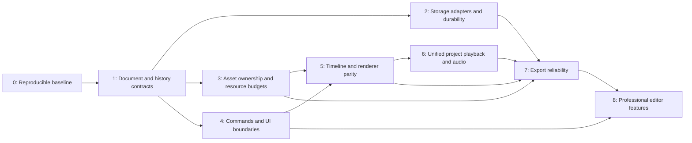

# Professional editor upgrade preparation

Audit date: 2026-10-16. Architecture and evidence vocabulary: [ARCHITECTURE.md](ARCHITECTURE.md).

## Scope and non-negotiable contracts

The initial audit was followed by user-authorized implementation of scenes, object timing, keyframes/camera and SVG strokes. Preserve the current UI, global entry points, local/account project documents, legacy project loading, animation styles, text/crop/slice data, audio and export choices. No framework, canvas library, runtime dependency or database schema migration was added.

The sidebar rebuild is preserved. The audit ledger below describes the original baseline; the implementation section records subsequent behavior changes. Obsolete test expectations were corrected against verified source rather than reverting the application.

Compatibility gates for every future implementation slice:

1. Parse all app scripts, run unit and Chromium browser suites; account for every failure rather than deleting coverage.
2. Load fixtures for old single-scene documents and current multi-scene documents; save/reload through IndexedDB and a disposable account database.
3. Verify image/text metadata, original crops, slices, groups, visibility, timing, asset library, background, camera and audio. Preserve fields the new subsystem does not understand.
4. Compare before/after UI and rendered frames at start, intermediate timestamps, transitions and completion for each affected style.
5. Exercise actual encode/download/decode with supported codecs before claiming export parity. Mocks only validate orchestration.
6. Keep a rollback path: adapters at existing globals, opt-in subsystem switches where appropriate, and no irreversible storage conversion until read/write compatibility passes.

## Dependency-aware implementation sequence

### Phase 0 — establish the release baseline

**Depends on:** nothing. **Targets:** test harness, documentation, fixture corpus. **Addresses:** R13–R14.

- Use the actual HTTP app, deterministic test assets, isolated browser storage and mocked account sessions for browser unit/integration tests. Keep real account tests in a separately configured disposable database environment.
- Retain startup/error visibility; do not suppress page errors or silently skip unsupported codecs as successful exports.
- Record existing UI, project contracts and known failures. Archive reviewed fixtures with old/current schemas, text, crop/slices, parallel/hidden layers, all reveal styles, multiple scenes, audio and infinite canvas.
- Pin a reproducible Node/browser version for CI after checking deployment constraints. Current checkout was exercised with Node 23.4.0, npm 10.9.2, Playwright 1.64.0 on Windows; this is a measured environment, not a recommendation for a production runtime.
- Add HTTP smoke tests for protected APIs, localized assets and the deployment static-file allowlist. No production data access is needed.

**Exit gate:** reproducible commands, no unexplained failures, named fixture owners, artifact retention, and a documented codec/browser matrix. This audit improves the baseline but does not establish full end-to-end export or account certification.

### Phase 1 — document schema, invariants and history correctness

**Depends on:** phase 0. **Targets:** serialization/restore and undo. **Addresses:** R1, R6.

- Characterize duplicated scene/project/undo serializers with round-trip tests before extraction. Explicitly test editable text after undo, review strategy, camera/infinite mode, move/resize undo and scene transitions.
- Define a plain-data document contract, runtime-only state boundary and explicit version field with a read-compatible migration adapter. Keep v1 IndexedDB and old JSON documents readable; do not rewrite stored documents on open.
- Introduce commands with before/after data so mutation, history and invalidation happen in one place. First commands should be simple geometry/property changes, then content insertion/removal, then crop/slice/group/scene operations.
- Fix confirmed baseline history defects in small, independently reviewed patches with failing-before/passing-after tests. Do not bundle them into a broad renderer refactor.

**Exit gate:** representative load→save→load round trips; undo/redo restores every affected field; old documents retain images and metadata; one tested compatibility adapter remains available.

### Phase 2 — storage and account boundaries

**Depends on:** phases 0–1. **Targets:** IndexedDB adapter, REST adapter, autosave coordinator. **Addresses:** R3, R7, R11.

- Extract storage behind Promise-based APIs while preserving the current record shape. Resolve success only after transaction completion; expose quota, decode and network failures explicitly.
- Separate serialization from scene thumbnails and avoid repeated PNG encoding of unchanged source images. Introduce stable immutable asset references internally before considering Blob stores or server asset tables.
- Add revision/conflict handling for linked cloud projects with a compatible API migration. Test simultaneous tabs/devices and save/reload races; do not silently overwrite a newer revision.
- Add structured document validation, input bounds and safe DOM rendering of names. Test owner isolation, session expiration, malformed/oversized state and reset token lifecycle against a disposable database.

**Exit gate:** injected save failures cannot show success; local-first recovery works; account conflicts are visible; schema rollback remains possible; no user data migration without a tested backup/export path.

### Phase 3 — asset ownership and memory management

**Depends on:** phases 0–1; can overlap phase 2. **Targets:** AssetManager, caches, image/canvas lifetimes. **Addresses:** R3–R5, R8.

- Separate acquire/release ownership from per-frame lookups. A render must not increment persistent reference counts. Test duplicate sources, replacement/crop, scene changes and repeated project loads.
- Use stable asset identity with collision detection. Keep original/full-resolution source data for persistence/export and derive lower-resolution edit previews where measured beneficial.
- Budget decoded sources, working surfaces, previews, history and export buffers together. Close ImageBitmaps and release object URLs explicitly; distinguish estimated bytes from actual browser heap/GPU memory.
- Benchmark before changing algorithms: 1/10/50/100/200 layers, small/large sources, overlap/alpha, 720p/1080p/4K and growing infinite workspace.

**Exit gate:** no unbounded ownership growth; repeat-load/delete/export stress reaches a stable resource envelope; source fidelity survives all proxy/cache paths. Set numeric memory targets from measured CI hardware rather than inventing a universal threshold.

### Phase 4 — editor commands and UI boundaries

**Depends on:** phase 1; coordinate with phase 3. **Targets:** tools, selection, layer/scene UI, localization. **Addresses:** R1, R5, R12.

- Extract small modules by responsibility while leaving existing global handlers as adapters. Start with coordinate conversion/geometry and document commands; avoid changing all event wiring at once.
- Separate selection, drag/resize, crop and text tool lifecycle; introduce Pointer Events/capture only with mouse/touch/pen and lost-capture tests.
- Batch UI updates and stop rebuilding the whole layer panel for changes that only affect a value. Keep current tab layout, focus/keyboard behavior and right-hand layer controls.
- Replace English-text DOM discovery with stable IDs/data attributes and make translated strings view data. Audit hidden source control dependencies before removing any node.

**Exit gate:** existing gestures/shortcuts and screenshots remain valid; no focus loss from value updates; layout and localization tests pass; DOM handlers no longer own storage/rendering policy for extracted commands.

### Phase 5 — one timeline contract and renderer parity

**Depends on:** phases 1, 3 and 4. **Targets:** timing/reveal model, render adapters. **Addresses:** R1–R5.

- Use production timeline code in unit tests instead of maintaining a second unconnected algorithm in `tests/utils/timeline.mjs`.
- Specify milliseconds, frame sampling, animation order, parallel group timing, stop holds, draw/fade/instant behavior, hand pose and layer stacking independently of DOM/playback.
- Inventory every legacy setup/tick effect and compare it against the timestamp renderer. Preserve the legacy adapter until visual/timing parity or an explicit product-approved difference exists.
- Cache by document revision/asset identity rather than repeatedly joining data URLs. Render layer-sized surfaces or affected regions where profiling supports it.
- Move pure image preprocessing to workers only after ownership/serialization contracts are ready. Capability flags alone are not a worker implementation. Evaluate WebGL/WebGPU only if measured Canvas 2D limits justify a separate design.

**Exit gate:** same scene/timestamp/options produces agreed pixels across edit preview, seek and export for every supported style; ordering and completed-layer tests pass; documented frame-time benchmarks improve without changing output.

### Phase 6 — project transport and audio synchronization

**Depends on:** phase 5. **Targets:** scene sequence, playback clock, waveform. **Addresses:** R2, R9.

- Compile a project timeline with explicit scene offsets/transitions. Keep current selected timeline start and restart behavior while separating visual scene time from project/audio time.
- Introduce a transport state machine (idle/preparing/playing/paused/seeking/finished) with generation tokens for stale async completions.
- Cache waveform peak data; avoid rescanning all samples on every progress update. Keep long-audio continuation behavior documented and tested.
- Treat multitrack audio, trimming, fades and scene transitions as later product features with data model/API contracts, not implicit changes to existing projects.

**Exit gate:** deterministic cross-scene seek, no stale scene completion, known audio drift bounds on measured devices, and explicit export duration policy.

### Phase 7 — export as an isolated job

**Depends on:** phases 2, 3, 5 and 6. **Targets:** export renderer, codecs, muxing, cancellation. **Addresses:** R9–R10.

- Snapshot an immutable document at job start. Export the agreed scene/project scope without changing the interactive editor or relying on its audio clock.
- Use one tested scene sequence for preview and export. Add a two-scene encoded/decode regression that catches the current active-scene-only scope.
- Keep MP4/WebM/PNG settings and audio behavior. Make no-WebCodecs support explicit; test actual fallback routing, output extension/status and decoded media.
- Cover cancellation in preprocessing, encode backpressure, flush, CDN loading, FFmpeg and real-time fallback. Restore editor state and dispose resources on every exit path.
- Test real exports at 24/30/60 FPS with alpha/background, nonzero stops, multiple scenes and short/long audio. Use FFprobe and decoded-frame comparison for frame count, timestamps, duration, audio streams and final output.
- Decide whether to vendor pinned muxer/WASM/font assets for reliable offline operation. That is a dependency/deployment decision, not part of this audit.

**Exit gate:** playable, validated files on supported browsers; no silent truncation or missing audio; cancellation and repeated exports bounded in resources. Large-file streaming should be assessed separately from in-memory muxing.

### Phase 8 — professional feature rollout

**Depends on:** preceding gates for each affected subsystem. **Targets:** product work after architecture stabilization.

Candidate features include multi-selection, snapping/alignment, transform inspector, richer timeline editing, reusable components, keyboard tool modes and multitrack audio. Prioritize them with the product owner; this audit does not assume their requirements. Implement each as an additive command/model/UI slice with old-project defaults and migration tests. Framework migration is optional and needs a separate cost/benefit decision; it is not a prerequisite for a professional editor.

## Verification ledger

### Baseline before harness changes

| Command | Result |
| --- | --- |
| `npm run check` | Passed (`node --check server.js`). |
| `npm run test:unit` | 9 passed. These originally tested utility algorithms, not all production inline JavaScript. |
| `npm run build` | Exited 1: no build script exists. The app is served directly; no compilation artifact was claimed. |
| `npm run lint` | Exited 1: no lint script/configuration exists. No linter dependency was added. |
| `npm run build --if-present`, `npm run lint --if-present` | No-ops; not counted as successful build/lint verification. |
| `npm run test:browser` | 83 tests: 5 passed, 78 failed, 0 skipped, 0 flaky; approximately 269 seconds. |

The baseline report showed 75 rendering-test failures from `ReferenceError: i18n is not defined`: the `file://` fixture could not load root-relative assets. Three Home tests asserted `/` or `/?auth=google` while the server deliberately redirects to `/en` or `/en?auth=google`. These are pre-existing harness/expectation failures, not evidence of 78 independent editor bugs. The summarized original report was saved locally in ignored `tests/reports/audit-baseline.json` before subsequent runs.

### Harness and regression changes

- Playwright starts/stops the existing Express server on port 18083. No migration or database seed runs. `PLAYWRIGHT_BASE_URL` can point to an already-running HTTP instance; the caller owns that instance's lifecycle. Browser tests use one worker because the suite includes wall-clock rendering/deadline checks.
- Browser specs now use the real HTTP route and deterministic onboarding/session setup. Home expectations follow existing localized redirects.
- New syntax coverage parses application JS and inline scripts in Home, Studio, docs and the coordinate mapper; it does not execute them or substitute for lint.
- New browser coverage exercises multiple uploads without auto-placement, explicit library insertion, IndexedDB save/reload, width/height editing, deletion confirmation, undo/redo, legacy scene restoration with rich metadata, and offline export frame sequencing/cancellation/disposal with mocked codec/muxer.
- Existing renderer, assets, crop, sidebar, layer settings, timeline, infinite canvas, preview/audio, search, clipboard and export-fallback tests remain in the suite.

The final audit baseline run completed successfully: 10 unit tests, 88 ordinarily passing browser tests and two expected failures documenting R6 (Playwright displayed 90 passed). The subsequent implementation fixes R6 and removes both expected-failure annotations.

### Existing test drift corrected after HTTP startup was restored

The first HTTP aggregate run produced 80 passes and eight failures (88 browser tests). The affected expectations and fixtures were checked against existing source, without changing application behavior:

| Test area | Correction / evidence |
| --- | --- |
| Sidebar (two tests) | Expect current Presets / Drawing hand groups, expanded preset/hand cards and audio under Canvas. Hidden legacy source controls remain checked. |
| Scene restoration | Expect cleared selection (`null`) after `restoreEditorState`, while continuing to assert second-scene identity, generation and visible pixels. |
| Content focus | The current tab label is Images, not Upload. Library insertion/focus assertions remain. |
| Selection/collapse | Exercise the existing `openSettings: false` option, and additionally assert default selection opens settings. Newly added/selected layers open settings; other layers remain collapsed. |
| Auth return | The fixture creates a project with `updateUrl: false`, so its actual return route is `/en/studio`; assert that route is preserved. |
| Sequential timing | Layer insertion prepends, so `.at(-1)` returned the first layer for both fixture variables. Resolve the newly added layer by its unique fixture name; retain the existing 4950–5300 ms timing bound. Correct the same fixture mistake in the all-layer preset test. |

All nine targeted checks covering those corrections passed. No assertions about visual output, playback order or timing were removed to make them pass.

A subsequent concurrent aggregate run passed 87/88 but measured 1196.5 ms against the existing <1000 ms seek threshold. The same check passed in the earlier HTTP run and then with one worker. The threshold was not relaxed; shared CPU/GPU contention is a plausible cause, not a proven performance diagnosis. The checked-in harness now runs one worker to reduce that confounder. This is not evidence that every real project meets a one-second seek budget.

The first serial run also caught a race in the new test fixture: thumbnail clicks decode an image asynchronously, so immediately inspecting `state.layers[0]` could run before insertion. The new fixture now waits for the actual layer row before reading state; the application was not changed.

### Confirmed application defects retained explicitly

Two isolated runtime probes confirmed R6, independent of the test-harness failures:

- **Drag undo:** upload/add an image, clear history, drag, then undo. In the probe x moved from 590 to approximately 655.979; after undo x was still 655.979. Mouseup currently pushes the already-modified snapshot.
- **Undo metadata loss:** set a text layer's `kind`, `textProps` and fade review strategy, change opacity, then undo. Restored `kind`/`textProps` were absent and `reviewStrategy` became `draw`. The separate undo serializer omits these fields.

The initial audit marked these as expected failures. The subsequent implementation fixes both defects and runs these assertions as ordinary passing tests, including actual canvas drag and text metadata restoration.

### Modified files for this audit

| File | Audit change |
| --- | --- |
| `ARCHITECTURE.md` | Stack, ownership/data flow, features, compatibility contracts, render/export paths and evidence-qualified risk register. |
| `UPGRADE_PLAN.md` | Dependency sequence, migration/rollback gates, verification ledger and remaining risks. |
| `playwright.config.js` | Managed HTTP server instead of unsupported file URL startup; one worker for timing-sensitive checks. |
| `tests/browser/pages.spec.js` | Use the shared server and current localized route expectations; preserve the pre-existing sidebar test. |
| `tests/browser/rendering.spec.js` | HTTP startup/session fixture; verified current UI/selection assertions and correct layer identities in two fixtures. |
| `tests/browser/editor-regressions.spec.js` | Persistence/editing/legacy serialization/export orchestration regressions and two explicit baseline history failures. |
| `tests/unit/source-syntax.test.mjs` | Parse local app JS and inline scripts without adding build tools. |

The pre-existing `studio.html` / `studio-sidebar.css` UI changes are preserved. The audit itself introduced no package/dependency or Prisma migration. The subsequent implementation adds the version-2 document adapter and editor behavior described below.

## Implemented after the audit

| Files | Change and verification scope |
| --- | --- |
| `animation-model.js` | Shared deterministic interpolation, presets, camera transforms and additive migrations; direct unit coverage. |
| `animation-editor.js`, `animation-editor.css` | Functional scene object timeline and animation inspector; browser drag/resize, keyframe, duplicate/undo and persistence coverage. |
| `svg-drawing.js` | Cached actual-path strokes with conservative fallback; simple, compound, nested, filled and 80-path fixtures. |
| `studio.html` | Renderer integration, camera coordinate inversion, serialization/history integration, original SVG persistence, confirmed R6 fixes. |
| `tests/unit/animation-model.test.mjs` | Interpolation boundaries/easing, overlapping evaluation, inverse camera coordinates, migration round trips and preset final states. |
| `tests/browser/animation-editor.spec.js` | Real timeline gestures, save/reload, cross-scene undo/redo, repeated seek and shared preview/export frame comparison. |
| `tests/browser/svg-drawing.spec.js` and its snapshot directory | Pixel snapshots at intermediate/final timestamps, zero-frame transparency, original final fidelity, repeated seeks, hand point and explicit fallback. Windows Chromium baselines; other platforms require reviewed baselines. |

Dependency order implemented: pure model → additive storage/history fields → deterministic renderer → timeline UI → SVG renderer/fallback → integration and regression tests. No migration writes to a database were performed.

Production qualification still requires real codec/audio export validation, cloud save/load with disposable credentials, profiling at representative project sizes and cross-browser testing. Existing active-scene export scope is retained; a full-project scene encoder remains a follow-up. SVG fallback is an explicit supported mode, not evidence that arbitrary SVG markup can be traced faithfully.

### Implementation verification results (2026-10-16)

- `npm run test:all`: passed server syntax check, 16 unit tests and 101 Chromium browser tests, with no expected failures or skipped tests.
- Following the final text persistence/identity fix, the focused animation, SVG and editing suite passed all 19 tests, including the newly added real text re-edit regression. The browser suite now contains 102 tests; the full 102-test collection was not rerun as a whole after that final fix.
- Timeline seek compilation was moved inside its animation-frame batch so pointer event bursts do not repeatedly compile before rendering. The five animation-editor tests were rerun for this final change.
- `npm run check`, `npm run test:unit` and `git diff --check` passed on the final application source.
- `npm run build` and `npm run lint` were explicitly attempted and both exited 1 because neither script exists. The application is directly served HTML/JS; no successful bundler build or lint run is claimed.
- Ten reviewed SVG PNG baselines are checked in. The ordinary browser run compared them without snapshot-update mode. Pixel checks also verify blank start, repeated seeks, original-image final output, a known stroke hand point and shared preview/export rendering after scene restoration.
- Full suite runtime was approximately 2.5 minutes for Chromium. This is verification runtime, not an editor performance benchmark.

## Remaining verification boundaries

- No real user database, signup/reset mail, Google OAuth exchange, cloud save conflict or ownership integration test was executed. Browser authentication fixtures mock responses; server starts without needing a DB for static routes.
- Codec/muxer orchestration tests do not create playable media. Existing FFmpeg-failure tests also mock boundaries. Full real MP4/WebM encode→download→FFprobe→decode with soundtrack and multiple scenes remains a release gate.
- Chromium only; Firefox, Safari, Edge, touch and pen are not certified. FFprobe capability detection is not evidence of exported-file validation.
- No large-project percentile performance baseline, long-session heap retention run or production load test. Existing seek/drag tests constrain selected scenarios only.
- Public README/privacy/documentation wording is not silently rewritten here. Statements about no accounts, static-only deployment, automatic upload placement and universal fallback need a deliberate follow-up against current behavior.
- A successful syntax/startup/test run establishes the direct-serve baseline; there is no existing build pipeline to claim was compiled successfully.
